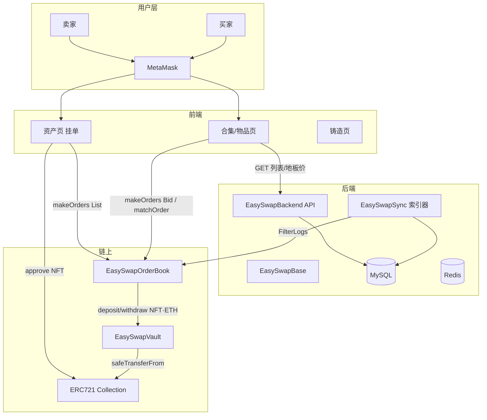
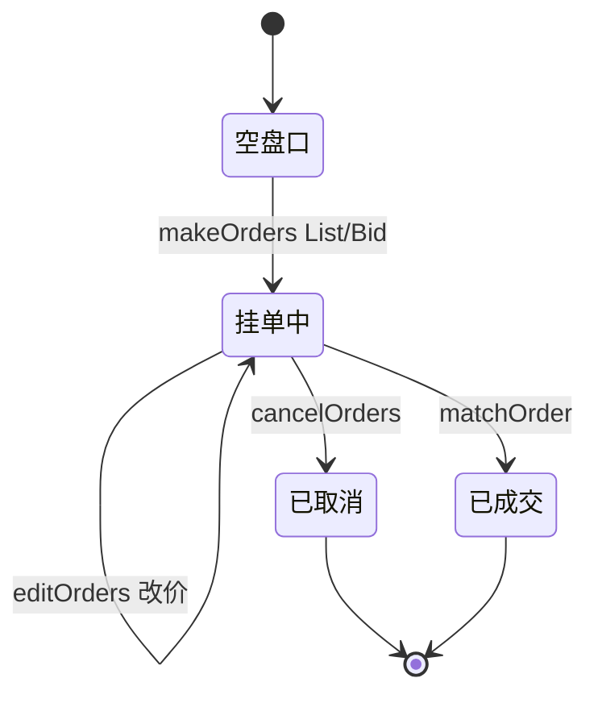
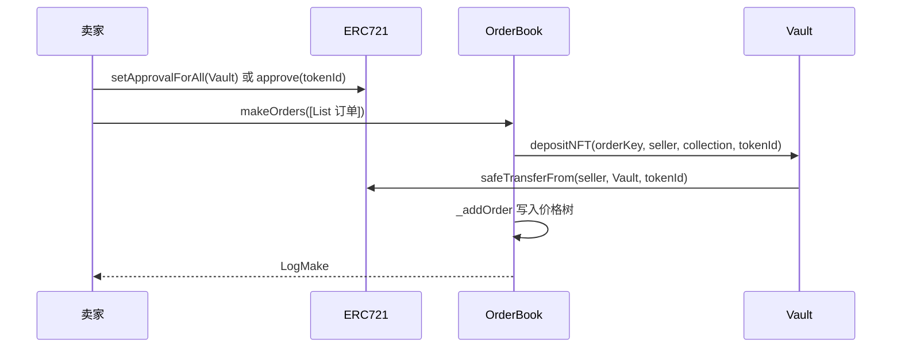
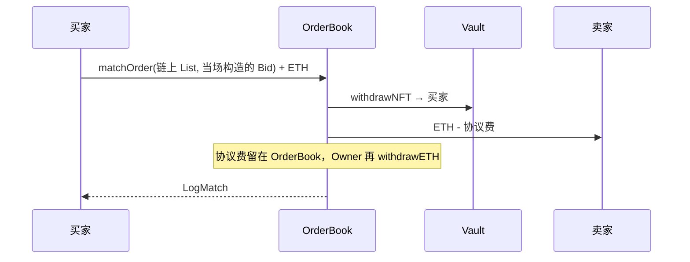
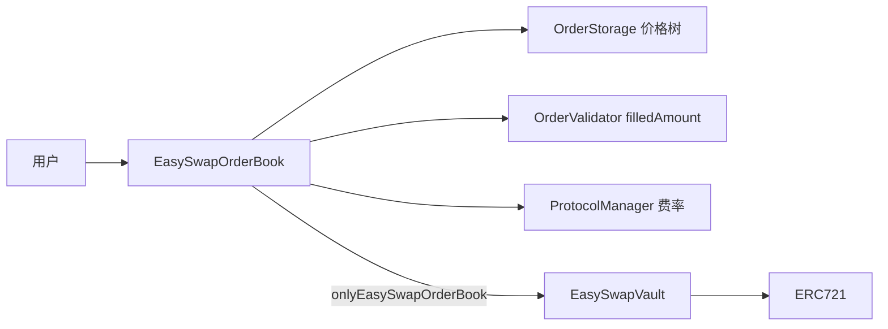
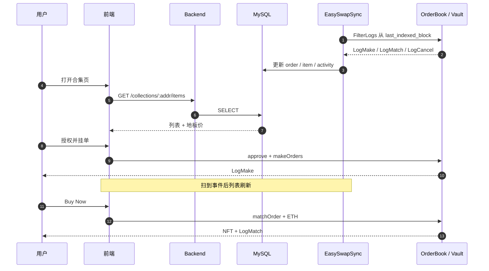

# NFTMarket（EasySwap）项目拆解文档

> 学习目标：从**业务**理解项目，而不是背代码。读完应能独立画出架构图、讲清挂单/出价/成交、说明合约与同步服务职责。  
> 代码依据：`EasySwapContract`、`EasySwapSync`、`EasySwapBackend`、`EasySwapBase`、`nft-market-fe`。  
> 仓库：https://github.com/MetaNodeAcademy/ProjectBreakdown-NFTMarket

---

## 0. 一句话讲清这个项目

EasySwap 是一个 **链上订单簿（OrderBook DEX）形态的 NFT 市场**。

卖家把 NFT 锁进金库并挂单价；买家把 ETH 锁进金库并出价；任意一方都可以来「吃单」。成交时合约同时完成 NFT 过户、ETH 结算和协议抽成。链下服务不托管资产，只把 `LogMake` / `LogCancel` / `LogMatch` 扫进数据库，给前端做列表、地板价和活动流。

它和 OpenSea（Seaport）的差别要先讲清：OpenSea 订单主要在**链下签名**，上架几乎不花 gas，成交才上链；EasySwap 订单写在**链上**，上架就要 gas，同时资产被托管，盘口可以按价格树直接查。

---

## 1. 项目解决什么问题

| 对比维度 | OpenSea / Seaport | EasySwap |
| --- | --- | --- |
| 订单存放 | 链下签名，中继器广播 | 合约存储 + 红黑树盘口 |
| 上架成本 | 低（通常只需授权） | 高（`makeOrders` 上链 + 锁资产） |
| 资产托管 | 成交瞬间从卖家钱包转出 | 挂单时 NFT/ETH 进入 Vault |
| 撮合 | Taker 提交签名订单 | Taker 调 `matchOrder`，合约校验盘口 |
| 价格发现 | 链下聚合 | 链上 `getBestPrice` / `getBestOrder` |
| 取消 | 链上 cancel 或过期 | `cancelOrders` 退回托管资产 |

**业务上的三个关键选择：**

1. **订单在链上。** 盘口可验证、可查询，不必信任中继器；代价是挂单就要付 gas、锁资产。
2. **金库与订单簿分离。** `EasySwapVault` 只认 OrderBook 地址，资产进出有单一入口。
3. **成交必须有人主动 match。** 合约不会自动把最优买卖价对敲。前端或用户构造 `sellOrder + buyOrder` 再调用。

---

## 2. 仓库怎么拆

```
ProjectBreakdown-NFTMarket/
├── EasySwapContract/     # 智能合约（Hardhat + Solidity 0.8.19，可升级）
├── EasySwapSync/         # 事件索引：扫 LogMake / LogCancel / LogMatch
├── EasySwapBackend/      # HTTP API：Collection / Item / Order / Activity
├── EasySwapBase/         # 共享库：DB 模型、链客户端、订单管理器
└── nft-market-fe/        # Next.js 前端（钱包写链 + 调 API 读列表）
```

读代码时记住：**NFT 和 ETH 以合约为准；Sync 是事件索引；Backend 是只读查询；前端是操作入口。**

---

## 3. 整体架构图



**分工一句话：**

- **OrderBook**：挂单、改价、取消、撮合。
- **Vault**：按 `OrderKey` 托管 NFT 和 ETH。
- **Sync**：按区块扫事件入库，维护断点 `last_indexed_block`。
- **Backend**：给前端提供合集、物品、出价、活动、投资组合。
- **前端**：展示走 REST；上架/出价/购买走钱包。

---

## 4. 角色、订单与资产

### 4.1 角色

| 角色 | 做什么 | 对应合约动作 |
| --- | --- | --- |
| 卖家 Maker（List） | 锁 NFT，挂固定单价 | `approve(Vault)` → `makeOrders(List)` |
| 买家 Maker（Bid） | 锁 ETH，对单品或整集合出价 | `makeOrders(Bid)` + `msg.value` |
| Taker | 吃对方已存在的单 | `matchOrder(sell, buy)` |
| 协议 Owner | 改费率、暂停、提取协议费 | `setProtocolShare` / `pause` / `withdrawETH` |

同一用户可以既是 Maker 又是 Taker：挂单后等人来买，也可以自己去吃别人的出价。

### 4.2 订单结构（`LibOrder.Order`）

| 字段 | 含义 |
| --- | --- |
| `side` | `List=0` 卖 / `Bid=1` 买 |
| `saleKind` | `FixedPriceForCollection=0` 集合出价 / `FixedPriceForItem=1` 单品 |
| `maker` | 必须等于 `msg.sender` |
| `nft.collection / tokenId / amount` | NFT；List 的 amount 必须为 1 |
| `price` | **单价**（uint128） |
| `expiry` | unix 秒；`0` 表示永不过期 |
| `salt` | 防哈希碰撞，不能为 0 |

`OrderKey = hash(Order)`，整单内容变一点，key 就变。所以改价不是改字段，而是 **取消旧单 + 建新单**。

### 4.3 两种成交路径

**路径 A：买家吃挂单（最常见「Buy Now」）**

1. 卖家已 `makeOrders(List)`，NFT 在 Vault。
2. 买家构造一个匹配的 Bid（可以不先上链），调 `matchOrder`。
3. 买家当场付 ETH（`msg.value >= 挂单价`），NFT 从 Vault 转给买家。

**路径 B：卖家吃出价**

1. 买家已 `makeOrders(Bid)`，ETH 在 Vault。
2. 卖家构造或使用已有 List，调 `matchOrder`。
3. 从 Vault 扣买家 ETH 给卖家（扣协议费），NFT 从 Vault 或卖家钱包转给买家。

集合出价（`FixedPriceForCollection`）只出现在 Bid 侧：买的是「这个合约下任意一个 token」，成交时 tokenId 以卖单为准。

---

## 5. 核心业务流程



链上订单状态靠两张表：

- `orders[orderKey]`：还在盘口里（红黑树 + 同价链表）
- `filledAmount[orderKey]`：`0` 未成交；累加部分成交；`type(uint256).max` 已取消

---

## 6. 完整用户旅程

### 6.1 卖家挂单



### 6.2 买家立即购买（Taker 构造 Bid，不必事先 make）



### 6.3 买家先出价，卖家后接受

买家 `makeOrders(Bid)` 把 ETH 锁进 Vault；卖家 `matchOrder` 时 `msg.value` 必须为 0，钱从 Vault 出。

前端对应：

| 步骤 | 页面 | 调用 |
| --- | --- | --- |
| 浏览合集/物品 | `app/collections` | Backend GET `/collections/...` |
| 授权 + 挂单 | `portfolio` listing 弹窗 | `approveNFT` → `makeOrders` |
| 出价 | `place-bid-dialog` | `makeOrders(Bid)` |
| 立即购买 | listings 表 / 物品页 | `matchOrder` 或 `buyNowWithMulticall` |

---

## 7. 合约层

### 7.1 合约如何协作



`EasySwapOrderBook` 多重继承：`OrderStorage` + `ProtocolManager` + `OrderValidator`，再单独指向 Vault。可升级（UUPS/Transparent 那一套 OZ Initializable），存储末尾都留了 `__gap`。

| 合约 | 职责 |
| --- | --- |
| `EasySwapOrderBook.sol` | 对外入口：make / cancel / edit / match / multicall |
| `EasySwapVault.sol` | 按 OrderKey 托管 ETH、NFT |
| `OrderStorage.sol` | collection × side 的红黑树 + 同价 FIFO 队列 |
| `OrderValidator.sol` | 参数校验、filledAmount、取消标记 |
| `ProtocolManager.sol` | `protocolShare`，上限 1000/10000 = 10% |
| `LibOrder.sol` | 订单结构与哈希 |
| `LibPayInfo.sol` | `TOTAL_SHARE=10000`，`MAX_PROTOCOL_SHARE=1000` |
| `RedBlackTreeLibrary.sol` | 价格排序：Bid 取最高，List 取最低 |

### 7.2 用户操作 → 合约方法

| 业务 | 方法 | 谁能调 | 资产变化 |
| --- | --- | --- | --- |
| 批量挂单/出价 | `makeOrders` | maker = msg.sender | List 锁 NFT；Bid 锁 ETH |
| 批量取消 | `cancelOrders` | 仅 maker | NFT/未成交 ETH 退回 |
| 改价改数量 | `editOrders` | 仅 maker | 取消旧单 + 建新单，Vault `editNFT/editETH` |
| 成交 | `matchOrder` | 卖单 maker 或买单 maker | NFT 过户，ETH 结算，扣协议费 |
| 批量成交 | `matchOrders` | 同上 | delegatecall 逐笔，失败记事件不回滚整批 |
| 聚合操作 | `multicall` | 用户 | 一笔交易里串联 make/cancel/edit/match；最多 1 个消耗 msg.value 的子调用 |
| 查最优价 | `getBestPrice` / `getBestOrder` | 任意 | 无 |
| 分页盘口 | `getOrders` | 任意 | 无 |

### 7.3 盘口数据结构（读 OrderStorage 的钥匙）

每个 collection、每个方向一棵价格树：

```
priceTrees[collection][List]  → 最低价在树根一侧（first）
priceTrees[collection][Bid]   → 最高价（last）

orderQueues[collection][side][price] → 链表 head/tail
orders[orderKey] → { order, next }
```

同价按时间先进先出：新单接到 tail。  
`getBestOrder` 从最优价往下走，跳过过期单和 tokenId 不匹配的单品 Bid。

这就是「链上订单簿」四个字的实现：不是 mapping 随便存，而是按价格可遍历。

### 7.4 资金如何流转

**挂 List：** NFT 卖家 → Vault，记 `NFTBalance[orderKey] = tokenId`  
**挂 Bid：** ETH 买家 → Vault，记 `ETHBalance[orderKey] += 金额`（金额 = 单价 × amount）

**买家吃 List：**

```
买家 msg.value ≥ fillPrice（挂单价）
Vault.withdrawNFT → 买家
卖家收到 fillPrice - protocolFee
多余 ETH 退买家
协议费留在 OrderBook
```

**卖家吃 Bid：**

```
买家 ETH 从 Vault 提到 OrderBook
卖家收到 fillPrice - protocolFee（fillPrice 用 Bid 价）
NFT：若卖单已在盘口则 Vault.withdrawNFT；否则 transferERC721 直接从卖家钱包转
```

协议费计算：

```
fee = fillPrice × protocolShare / 10000
```

例如 share = 250 → 2.5%。Owner 调 `withdrawETH` 提走积在 OrderBook 里的手续费。

### 7.5 撮合校验 `_isMatchAvailable`

必须同时满足：

- 不是同一笔 orderKey
- sell 是 List，buy 是 Bid
- sell 的 saleKind 是 **FixedPriceForItem**（卖的一定是具体 token）
- 买卖双方 maker 不同
- 资产匹配：集合出价，或 collection+tokenId 都相同
- 双方都未完全成交

注意：合约**不检查**「买价必须 ≥ 卖价」在 `_isMatchAvailable` 里。买家吃单时才 `require(buyPrice >= fillPrice)` 或 `msg.value >= fillPrice`。卖家吃出价时成交价直接用 **Bid 价**。

### 7.6 和 Seaport 对照时值得讲的点

- 资产先托管，挂单不可再拿到别的市场去卖（除非先 cancel）。
- `makeOrders` 失败的单会 `LogSkipOrder` 而不是整笔 revert，批量里允许部分成功。
- `matchOrders` 用 delegatecall，单笔失败不拖垮整批，靠 `BatchMatchInnerError` 暴露原因。
- List 限制 `amount == 1`，当前就是 ERC721 市场，不是 1155 通用市场。

---

## 8. 后端层

### 8.1 为什么要后端

链上可以 `getOrders` 分页，但前端还需要：

- 合集封面、描述、trait、地板价、成交历史
- 跨页搜索、排行榜、用户投资组合
- 活动流（mint / list / sale / transfer）

所以后端做 **索引 + 查询**。用户成交不经过后端。

和 Pledge 的差别：Pledge 的 schedule **轮询 view**；这里的 Sync **扫事件日志**。NFT 订单事件稀疏、需要精确到每笔订单，用 FilterLogs 更合适。

### 8.2 三个 Go 模块

| 模块 | 入口 | 职责 |
| --- | --- | --- |
| EasySwapSync | `go run main.go daemon` | 扫 OrderBook 事件，写订单/活动/地板价 |
| EasySwapBackend | `src/main.go` | gin API |
| EasySwapBase | 被前两者 replace 引用 | 表结构、chain client、OrderManager |

### 8.3 Sync：事件监听与入库

`EasySwapSync/service/orderbookindexer/service.go`：

1. 读表 `indexed_status` 的 `last_indexed_block`
2. `BlockNumber()` 减确认数（sepolia 配了 8 块）得到安全高度
3. `FilterLogs`：地址 = Dex 合约，区间最多约 1000 块
4. 按 topic 分发：

| Topic | 事件 | 入库 |
| --- | --- | --- |
| `LogMake` | 挂单/出价 | 订单表 + activity |
| `LogCancel` | 取消 | 订单状态关闭 |
| `LogMatch` | 成交 | 订单成交、item owner、成交价、activity |
| ERC721 Approval | 授权 | 辅助状态 |

5. 写回 `last_indexed_block`，下一轮从这里续扫

还有 `UpKeepingCollectionFloorChangeLoop` 维护地板价。`EasySwapBase/ordermanager` 用时间轮处理过期订单缓存。

这是标准的「链上日志索引器」：有断点、有确认延迟、有分叉检查（`checkAndHandleFork`）。

### 8.4 API 设计（`/api/v1`）

| 路径 | 用途 |
| --- | --- |
| `GET /collections/ranking` | 排行榜（Redis 缓存 60s） |
| `GET /collections/:address` | 合集详情 |
| `GET /collections/:address/items` | 物品列表 |
| `GET /collections/:address/:token_id` | 物品详情 |
| `GET /collections/:address/bids` | 集合出价 |
| `GET /collections/:address/:token_id/bids` | 单品出价 |
| `GET /activities` | 活动流 |
| `GET /portfolio/*` | 用户合集/物品/挂单/出价 |
| `GET /bid-orders` | 出价订单 |
| `POST /user/login` | 钱包签名登录 |
| `POST /metanode/mint` | 测试 NFT 铸造相关 |
| `POST /admin/...` | 导入合集、同步 metadata |

Controller 不发用户交易。`chain_id` 用来分表（如 `ob_order_sepolia`）。

### 8.5 数据模型（和 README 里的表一致）

| 表 | 对应实体 |
| --- | --- |
| `ob_collection_*` | 合集：地板价、总成交量、封面 |
| `ob_item_*` | 单个 NFT：owner、挂单价、上次成交价 |
| `ob_order_*` | 链上订单镜像：hash、type、price、maker |
| `ob_activity_*` | 事件：Buy/Mint/List/Cancel/Offer/Sell/Transfer |

链是账本，表是给前端用的只读投影。

---

## 9. 前端层

Next.js App Router。核心链上封装：`nft-market-fe/contracts/service/orderBookContract.ts`。

| 页面 | 业务 |
| --- | --- |
| `/collections` | 市场首页、排行 |
| `/collections/[name]` | 合集物品、挂单表、出价 |
| `/collections/[name]/[tokenId]` | 物品详情、购买 |
| `/portfolio` | 我的 NFT、挂单弹窗 |
| `/activity` | 活动 |
| `/mint` | 铸造测试 NFT |

数据来源：

```
合集、物品、地板价、活动  →  Backend HTTP
当前授权、余额           →  ERC721 / 钱包
挂单、出价、购买         →  OrderBook.send
```

授权对象是 **Vault 地址**，不是 OrderBook。漏授权时 `depositNFT` 会失败。

---

## 10. 三端数据流转



三条铁律：

1. **钱和 NFT 只在 Vault / OrderBook 里动。**
2. **列表可以延迟几个区块**（确认数 + 扫块周期）。
3. **成交参数必须和链上订单字节级一致**，否则 hash 对不上，match 会失败。

---

## 11. 从业务角度怎么读代码

### 第一遍：订单长什么样（1 小时）

`LibOrder.sol` → `EasySwapVault.sol` 的 deposit/withdraw。问：挂单时资产去哪了？

### 第二遍：盘口（2 小时）

`OrderStorage._addOrder` / `_removeOrder` / `getBestPrice`。在纸上画「同一 collection 三个卖价」的树和链表。

### 第三遍：成交（2 小时）

`_matchOrder` 两个分支（`msg.sender == sell.maker` vs `buy.maker`）对照着读。每一步标注 NFT 从哪到哪、ETH 从哪到哪。

### 第四遍：索引（1 小时）

`SyncOrderBookEventLoop` → `handleMakeEvent`。对照 Pledge 的「轮询 PoolBaseInfo」，能说出为什么这里必须扫 log。

---

## 12. 同类型项目对照

| 问题 | EasySwap 的答案 | 换项目时看哪里 |
| --- | --- | --- |
| 订单在链上还是链下 | 链上 | 搜 Order 是 `mapping` 还是 `signature` |
| 资产谁托管 | Vault，仅 OrderBook 可动 | 搜 custody / vault / escrow |
| 价格怎么排 | 红黑树 + FIFO | 搜 bestPrice / heap / sorted |
| 成交谁发起 | Taker 调 match | 搜 fill / match / take |
| 协议费 | protocolShare / 10000 | 搜 fee / royalty |
| 后端是否管钱 | 否，扫事件 | 搜 FilterLogs vs 私钥发交易 |
| 索引方式 | 事件 + 断点区块 | 搜 last_indexed_block / subgraph |

先画「用户 → 前端 → 合约 / 索引器」三条线，再补「List vs Bid」两条资金流。

---

## 13. 讲解提纲

**1. 这是什么**  
链上 NFT 订单簿。挂单锁资产，Taker 来撮合，协议从成交额抽成。

**2. 和 OpenSea 的差别**  
订单上链、资产预托管、盘口可链上查询；不是链下签名成交时才上链。

**3. 钱和 NFT 怎么走**  
List：NFT 进 Vault。Bid：ETH 进 Vault。match：NFT 给买家，ETH 扣费后给卖家，费留在 OrderBook。

**4. 合约怎么分工**  
OrderBook 管盘口和撮合；Vault 管托管；价格树决定最优单。

**5. 后端干什么**  
Sync 扫 `LogMake/Cancel/Match` 入库；API 给前端列表。不管钱。

**6. 风险点**  
- 挂单锁定资产，卖家不能同时在别的市场卖  
- match 不自动对敲，依赖前端构造对手单  
- 协议费积在 OrderBook，靠 Owner 提取  
- 索引有确认延迟，前端列表不是即时链上状态  

---

## 14. 读完后的自检

1. 挂单时 NFT 授权给 OrderBook 还是 Vault？
2. 改价为什么必须换 OrderKey？
3. 买家 Buy Now 一定要先 `makeOrders` 吗？
4. 卖家接受 Bid 时为什么 `msg.value` 必须为 0？
5. 集合出价成交时 tokenId 以哪一侧为准？
6. `filledAmount == type(uint256).max` 表示什么？
7. Sync 和 Pledge 的 schedule 同步方式差在哪？
8. 前端列表上的地板价是链上 `getBestPrice` 现查，还是库里算出来的？
