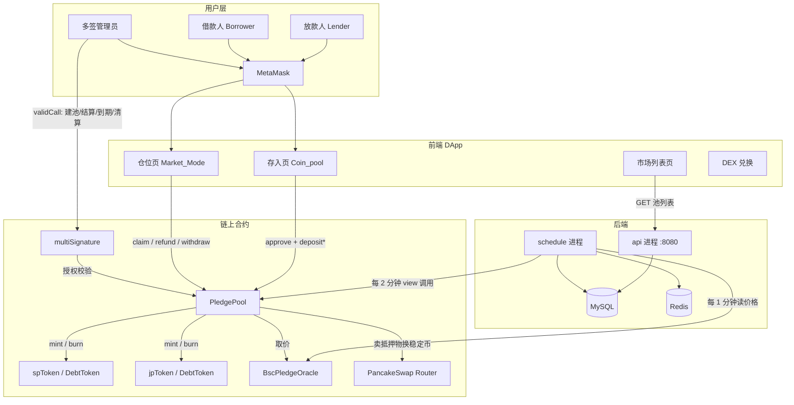
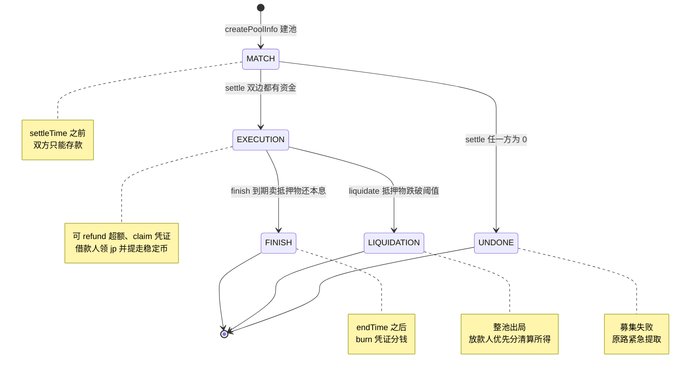
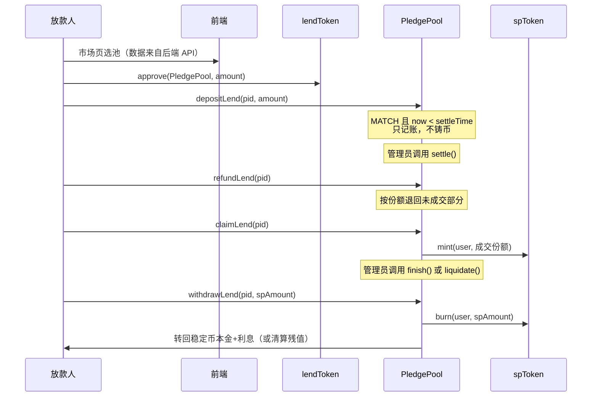
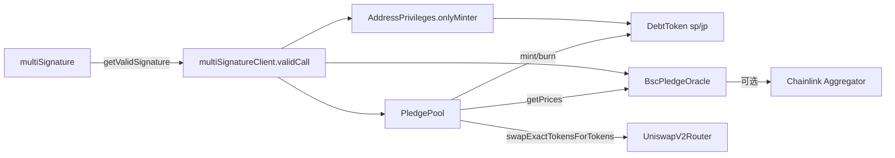
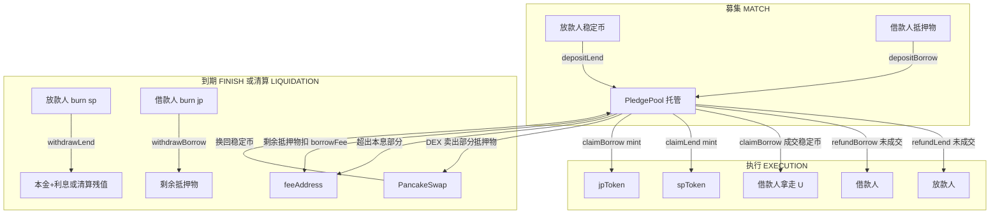
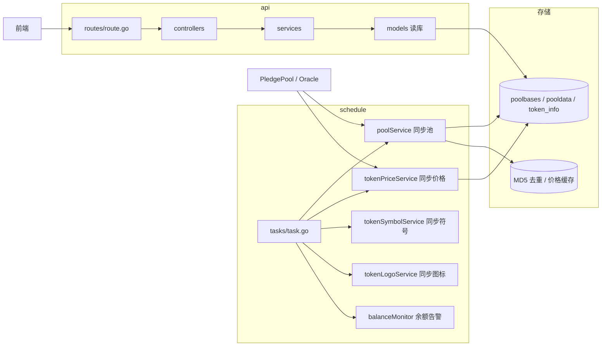
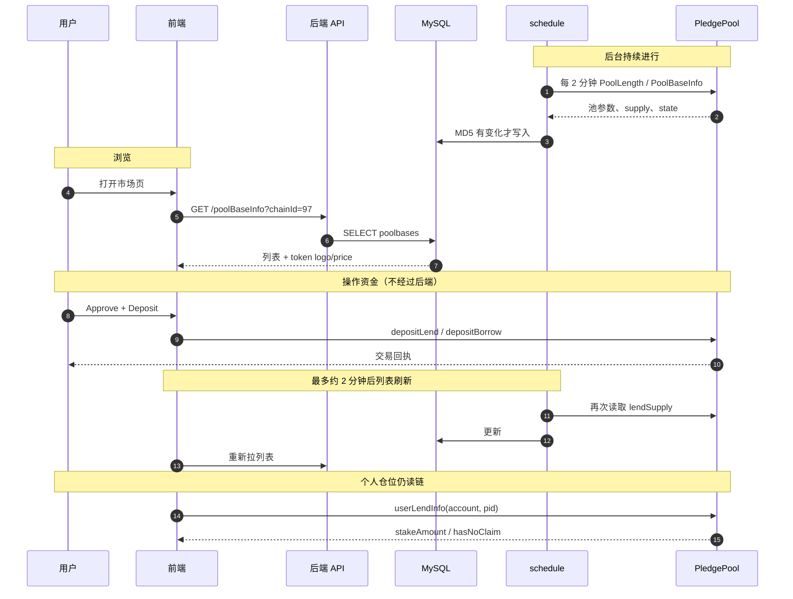

# Pledge 项目拆解文档

> 学习目标：从**业务**理解项目，而不是背代码。读完应能独立画出架构图、讲清核心流程、说明各模块职责，并快速对照同类型 Web3 借贷项目。
>
> 代码依据：当前仓库 `pledgev2`（合约）、`pledge-backend`（后端）、`pledge-fe`（前端）。  
> 仓库：https://github.com/MetaNodeAcademy/ProjectBreakdown-Pledge

---

## 0. 一句话讲清这个项目

Pledge 做的是 **固定利率、固定期限的抵押借贷**。

管理员先建一个「期限 + 利率 + 抵押率」都锁死的资金池；放款人在结算日前存入稳定币，借款人存入抵押物（如 BTC）。到期后合约按事先锁定的利率卖出抵押物、还本付息；中途抵押物跌破阈值则整池清算。

它要填的市场空白是：Aave / Compound 一类协议是**浮动利率、随时存取**，主要服务短线交易；Pledge 把「期限」和「利率」在建池时写死，服务的是需要确定性融资成本的中长期需求。

---

## 1. 项目解决什么问题

| 对比维度 | Aave / Compound | Pledge |
| --- | --- | --- |
| 利率 | 由资金利用率实时浮动 | 建池时锁定，到期才结算 |
| 期限 | 无固定到期日，随时借还 | 有 `settleTime`（撮合）和 `endTime`（到期） |
| 撮合方式 | 资金池共享，随存随借 | 募集期双边存入，到期一次性撮合 |
| 清算粒度 | 按单个借款人仓位 | **整池一次性清算** |
| 凭证 | aToken / cToken 随存随铸 | settle 之后才 mint `spToken` / `jpToken` |

**业务上的三个关键选择：**

1. **先存后撮、不先发凭证。** 存款阶段只记账，能不能成交要等 `settle()`。先铸再退会把凭证逻辑绕死。
2. **利息在建池时就确定。** `interest = 期限占比 × 年化利率 × 成交本金`。这就是「固定利率」的合约含义。
3. **链上没有 cron。** `settle` / `finish` / `liquidate` 必须由多签持有者主动发交易。合约只校验时间与状态，不会自己跳状态。

---

## 2. 仓库怎么拆

```
ProjectBreakdown-Pledge/
├── Pledge/                 # 需求清单、业务流程说明（学习材料，不是运行代码）
├── pledgev2/               # 智能合约（Hardhat + Solidity 0.6.12）
│   └── contracts/
│       ├── pledge/         # 核心：PledgePool / DebtToken / Oracle / 权限
│       ├── multiSignature/ # 多签治理
│       ├── library/        # SafeTransfer 等
│       └── mock/           # 测试用代币与 Uniswap
├── pledge-backend/         # Go 后端，拆成两个进程
│   ├── api/                # HTTP API（给前端读列表）
│   └── schedule/           # 定时任务（把链上状态镜像进 MySQL）
└── pledge-fe/              # React DApp（钱包写链 + 调后端读列表）
```

读代码时记住：**资金与状态以合约为准；后端是只读索引；前端是操作入口。**

---

## 3. 整体架构图



**分工一句话：**

- **合约**：管钱、管状态机、管清算。
- **后端 schedule**：定时把合约 `view` 数据抄进数据库。
- **后端 api**：给前端提供池列表、代币信息、价格。
- **前端**：展示列表走 HTTP；存取款、领凭证走钱包直连合约。

---

## 4. 角色、资产与凭证

### 4.1 角色

| 角色 | 做什么 | 对应合约动作 |
| --- | --- | --- |
| 放款人 Lender | 存稳定币，到期拿本金 + 固定利息 | `depositLend` → `claimLend` → `withdrawLend` |
| 借款人 Borrower | 押加密资产，settle 后提走稳定币 | `depositBorrow` → `claimBorrow` → `withdrawBorrow` |
| 多签管理员 | 建池、撮合、到期结算、清算、改参数 | `createPoolInfo` / `settle` / `finish` / `liquidate` |
| 平台 | 收 lendFee / borrowFee | `feeAddress` |

### 4.2 一个池子里的两类资产

- **lendToken**：放款资产，通常是稳定币（BUSD / DAI）。`address(0)` 表示原生币（BNB）。
- **borrowToken**：抵押资产（BTC / BNB）。名字容易误导：这里的「borrow」指借款人拿来抵押的币，不是借出去的币。

### 4.3 两种凭证（都是 `DebtToken`）

| 凭证 | 给谁 | 何时铸造 | 含义 | 何时销毁 |
| --- | --- | --- | --- | --- |
| **spToken**（Share / 放款凭证） | 放款人 | `claimLend` | 对池内「成交本金」的份额 | `withdrawLend` 时 burn，按份额分本息 |
| **jpToken**（Debt / 借款欠条） | 借款人 | `claimBorrow` | 到期要对应赎回的抵押物份额 | `withdrawBorrow` 时 burn，按份额拿剩余抵押物 |

数量关系（settle 之后）：

```
sp 总量 ≈ settleAmountLend
jp 总量 = settleAmountLend × martgageRate / 1e8
```

例如：成交借款 20000 U，抵押率 150% → jp 总量 = 30000。jp 不是「借到了多少 U」，而是「这笔债对应多少抵押物份额」。

---

## 5. 核心业务流程：池状态机

整个项目围着一张状态机转。**先背这张图，再看函数。**



时间轴：

```
建池 ──募集期── settleTime ──执行期── endTime ──完成
         MATCH              EXECUTION          FINISH
                              │
                              └── 抵押物贬值 → LIQUIDATION
```

每个用户函数都挂了三层门禁：`notPause` + 时间修饰器 + 状态修饰器。读任意函数，先看修饰器，就能知道它属于哪一段生命周期。

---

## 6. 完整用户旅程（对照前端页面）

### 6.1 放款人



前端对应：

| 步骤 | 页面 / 组件 | 调用 |
| --- | --- | --- |
| 看池子 | `pages/Dapp/Home` | `userServer.getpoolBaseInfo`（HTTP） |
| 授权 + 存款 | `components/Coin_pool` | `ERC20Server.Approve` → `PoolServer.depositLend` |
| 领 sp / 退超额 | `AccessTab` / `Refund` | `getclaimLend` / `getrefundLend` |
| 到期赎回 | `ClaimTime` | `getwithdrawLend` |
| 募集失败 | `Refund` | `getemergencyLendWithdrawal` |

### 6.2 借款人

和放款人对称，但 `claimBorrow` 会**当场把稳定币打给借款人**，同时 mint jpToken：

1. `approve(borrowToken)` → `depositBorrow`
2. settle 后 `refundBorrow`（退未成交抵押物）
3. `claimBorrow`：mint jp + `_redeem(lendToken)` 提走借款
4. 到期 `withdrawBorrow`：burn jp，拿回卖剩的抵押物

### 6.3 管理员（链下人工触发）

合约没有定时器。到点后必须有人发交易：

1. 多签：`createApplication(PledgePool地址)` → 达到阈值的 owner `signApplication`
2. 被授权的调用者执行 `settle` / `finish` / `liquidate`
3. `validCall` 只校验「这个调用者是否被批准操作这个合约」，**不绑定具体函数**

---

## 7. 合约层

### 7.1 合约如何协作



| 合约 | 职责 |
| --- | --- |
| `PledgePool.sol` | 唯一核心。建池、存取、撮合、到期、清算、收费 |
| `DebtToken.sol` | 极简 ERC20。只允许 minter mint/burn |
| `AddressPrivileges.sol` | minter 白名单。部署后把 PledgePool 加进去 |
| `BscPledgeOracle.sol` | 价格源：优先 Chainlink，否则管理员手写 `priceMap` |
| `multiSignature.sol` | 多签：创建申请、签名、达阈值 |
| `multiSignatureClient.sol` | `validCall`：执行前询问多签合约 |
| `SafeTransfer.sol` | 兼容 ERC20 与原生币的转入转出 |

部署顺序（见 `pledgev2/README.md`）：

1. `multiSignature`（先定管理员和阈值）
2. `DebtToken`（sp / jp，构造函数传入多签地址）
3. Oracle、SwapRouter
4. `PledgePool(oracle, swapRouter, feeAddress, multiSignature)`
5. `addMinter(PledgePool)`，否则 claim 时铸币会失败

### 7.2 用户操作 → 合约方法

| 业务动作 | 方法 | 谁能调 | 准入条件 | 链上资金变化 |
| --- | --- | --- | --- | --- |
| 建池 | `createPoolInfo` | 多签 | `validCall` | 无，只 push 两个 struct |
| 放款存入 | `depositLend` | 用户 | MATCH 且 `now < settleTime` | lendToken 转入池 |
| 借款存押 | `depositBorrow` | 用户 | 同上 | borrowToken 转入池 |
| 撮合锁定成交额 | `settle` | 多签 | MATCH 且 `now > settleTime` | **不转钱、不铸币，只记账** |
| 退未成交放款 | `refundLend` | 用户 | EXECUTION/FINISH/LIQUIDATION | 退 lendToken |
| 退未成交抵押 | `refundBorrow` | 用户 | 同上 | 退 borrowToken |
| 领放款凭证 | `claimLend` | 用户 | 同上 | mint spToken |
| 领借款 + 提稳定币 | `claimBorrow` | 用户 | 同上 | mint jpToken + 转出 lendToken |
| 到期结算 | `finish` | 多签 | EXECUTION 且 `now > endTime` | 卖抵押物 → 稳定币，扣费 |
| 爆仓清算 | `liquidate` | 多签 | EXECUTION 且 `now > settleTime` | 同上，无滑点保护 |
| 放款赎回 | `withdrawLend` | 用户 | FINISH 或 LIQUIDATION | burn sp，按份额转 lendToken |
| 借款赎回抵押 | `withdrawBorrow` | 用户 | 同上 | burn jp，按份额转剩余 borrowToken |
| 募集失败提款 | `emergencyLend/BorrowWithdrawal` | 用户 | UNDONE | 原路退回 stakeAmount |
| 暂停 | `setPause` | 多签 | `validCall` | 无 |

存款阶段**不 mint**。凭证发生在 claim。这是读代码时最容易和 Aave 搞混的一点。

### 7.3 settle：一次性撮合（最核心）

`settle()` 只做三件事：取价、按抵押率算能借多少、两边取小。

设抵押率 `martgageRate = 150% = 1.5e8`，借款人押了 1 BTC，预言机 BTC = 30000、稳定币 = 1：

```
抵押物价值 totalValue = 1 × (30000 / 1) = 30000 U
可支持借款 actualValue = 30000 × 1e8 / 1.5e8 = 20000 U
```

然后：

- 放款人存了 50000 U（供过于求）→ 成交 20000 U，多出的 30000 之后 `refundLend`
- 放款人只存了 15000 U（供不应求）→ 成交 15000 U，多余抵押物 `refundBorrow`

任一方 supply 为 0 → 状态变 `UNDONE`，走紧急提取。

**settle 不转钱。** 真正给借款人打稳定币的是之后的 `claimBorrow`。

### 7.4 固定利率怎么算

`finish()` 与 `liquidate()` 用同一套公式（`baseDecimal = 1e8`，`baseYear = 365 days`）：

```
timeRatio = (endTime - settleTime) × 1e8 / 365天
interest  = timeRatio × interestRate × settleAmountLend / 1e16
          = (期限/一年) × (interestRate/1e8) × 本金
lendAmount = 本金 + 利息
```

若年化 10%，`interestRate = 1e7`，期限半年，成交 20000 U → 利息 1000 U，到期应付 21000 U。

建池时利率和期限已锁死，所以到期利息在建池那一刻就可预知。这就是产品上的「固定利率」。

### 7.5 资金如何流转



资金安全设计：

- 放款人优先：卖抵押物先覆盖本息，剩余才还给借款人。
- 清算时没有 `require(amountIn >= lendAmount)`。滑点亏损记在 `liquidationAmounLend` 上，放款人可能收不回全额。`finish()` 有这道保护，清算没有——这是协议对「爆仓」的取舍。
- 清算是**整池**，不是 Aave 那种逐仓。一个池子爆仓，该池所有借款人一起出局。

### 7.6 清算条件

`checkoutLiquidate`：

```
抵押物现值 = settleAmountBorrow × (抵押物价 / 稳定币价)
清算线     = settleAmountLend × (1 + autoLiquidateThreshold)
现值 < 清算线 → 可清算
```

注意：判定用的是结算时锁定的 `settleAmount*`，不是用户事后补仓。settle 之后抵押物整池托管，没有「单独加保证金」这条路径。

另外：清算线用的是本金，**不含已计利息**。这和 `finish` 里「本金 + 利息」不是同一口径。

### 7.7 多签实际在保什么

`checkMultiSignature` 计算：

```
msgHash = keccak256(msg.sender, address(this))
```

含义：批准的是「某调用者 × 某目标合约」，不是「某一笔具体函数调用」。一旦签过，该调用者可以对这个合约的所有 `validCall` 方法生效。学习时把它理解成「管理员钥匙」，而不是链上 DAO 提案机。

敏感操作全部 `validCall`：建池、settle、finish、liquidate、改费率、改路由、暂停、给 DebtToken 加 minter、给 Oracle 写价格。

### 7.8 预言机

`BscPledgeOracle.getUnderlyingPrice`：

1. 若该资产配了 Chainlink Aggregator → `latestRoundData()`
2. 否则读管理员写入的 `priceMap`

生产安全性完全取决于价格源。settle 成交比例和清算触发都靠它。测试网常见路径是 `setPrice` 手写价格。

`setPrices` 循环里写的是 `priceMap[i]`（数组下标）而不是 `priceMap[assets[i]]`，和读取路径对不上。批量设价这条路实际无效，单笔 `setPrice(address, price)` 才是可用接口。

---

## 8. 后端层

### 8.1 为什么要后端

链上 `poolBaseInfo(i)` 可以查，但前端列表需要：

- 一次拿全部池子（避免前端对每个 pid 发 eth_call）
- 拼上代币符号、logo、法币价格
- 按 chainId 过滤、分页搜索

所以后端做的是 **只读索引服务**：把链上状态镜像到 MySQL，再通过 REST 吐给前端。  
**用户存取款不经过后端。** 后端也不替用户调 `settle`。

需求文档里写的「事件监听入库」是目标形态；**当前实现是轮询 view 函数，不是 FilterLogs。**

### 8.2 双进程结构

```
pledge-backend/
├── api/pledge_api.go          # gin HTTP + websocket + 库币行情
└── schedule/pledge_task.go    # gocron 定时读链
```

| 进程 | 入口 | 职责 |
| --- | --- | --- |
| API | `go run pledge_api.go` | 对外 HTTP、静态资源、PLGR 价格 websocket |
| Schedule | `go run pledge_task.go` | 定时同步池信息、预言机价格、代币元数据、余额告警 |

两边共享 `config/`、`db/`、`contract/bindings/`（abigen 生成的 Go 绑定）。

### 8.3 模块职责



| 路径 | 职责 |
| --- | --- |
| `schedule/services/poolService.go` | 核心同步：`PoolLength` → 逐池 `PoolBaseInfo` / `PoolDataInfo` → 入库 |
| `schedule/services/tokenPriceService.go` | 读 Oracle `GetPrice`，变化才写 `token_info.price`；测试网还会 `SetPrice` |
| `schedule/services/tokenSymbolService.go` | 读 ERC20 `symbol`，主网可拉远端 ABI |
| `schedule/services/tokenLogoService.go` | 从 Pancake token list 拉 logo |
| `schedule/services/balanceMonitor.go` | 池合约原生币余额过低发邮件 |
| `api/routes/route.go` | 全部 HTTP 路由 |
| `api/controllers/*` | 参数校验 + 调 service |
| `api/models/poolBases.go` | 把 `poolbases` 行转成前端要的 JSON |
| `contract/bindings/` | abigen 产物，schedule 用它发 eth_call |

### 8.4 链上数据同步流程（不是事件监听）

`tasks/task.go` 启动时先跑一轮，再按周期：

| 任务 | 周期 | 链上调用 | 写入 |
| --- | --- | --- | --- |
| `UpdateAllPoolInfo` | 2 分钟 | `PoolLength` / `PoolBaseInfo` / `PoolDataInfo` / Fee | `poolbases`、`pooldata` |
| `UpdateContractPrice` | 1 分钟 | Oracle `GetPrice` | `token_info.price` |
| `UpdateContractSymbol` | 2 小时 | ERC20 `symbol` | `token_info.symbol` |
| `UpdateTokenLogo` | 2 小时 | HTTP token list | `token_info.logo` |
| `BalanceMonitor` | 30 分钟 | `BalanceAt(pool)` | 邮件 |
| `SavePlgrPriceTestNet` | 30 分钟 | Oracle `SetPrice`（测试网写价） | 链上 |

同步策略：

1. 全量枚举 pid（新池最多延迟一个周期才出现在列表）
2. 把结构体 JSON 后算 MD5，和 Redis 旧哈希比较
3. **有变化才写 MySQL**，减少无意义 UPDATE

和「事件驱动索引」（The Graph / 自建 log 扫描）对比：轮询实现简单、不怕漏事件，但实时性差、gas 无关却耗 RPC。同类型项目里，订单簿/NFT 市场更常扫 event；这种池子数量很少的借贷协议，轮询够用。

注意：`poolService` 给 `data_info` 算 MD5 时传入的仍是 `poolBase`。`pooldata` 往往跟着 `poolbases.state` 一起变，所以多数时候能蒙对；若只有成交额字段变、基础信息不变更，可能漏更新。读代码时带着这个问题看即可。

### 8.5 API 设计

前缀：`/api/v` + `config.Env.Version`（当前 v21）。

| 方法 | 路径 | 鉴权 | 给谁用 |
| --- | --- | --- | --- |
| GET | `/poolBaseInfo?chainId=` | 无 | 市场列表（前端主接口） |
| GET | `/poolDataInfo?chainId=` | 无 | 成交额 settle/finish/liquidation |
| GET | `/token` | 无 | 代币清单（Uniswap tokenlist 形态） |
| POST | `/pool/search` | JWT | 管理端搜索 |
| POST | `/pool/debtTokenList` | JWT | sp/jp 列表 |
| GET | `/price` | 无 | PLGR 对 U 价格 |
| POST | `/pool/setMultiSign` | JWT | 管理端保存多签配置 |
| POST | `/pool/getMultiSign` | JWT | 读多签配置 |
| POST | `/user/login` | 无 | 管理登录（默认 admin/password） |
| POST | `/user/logout` | JWT | 登出 |

分层：`routes → controllers → validate → services → models → MySQL`。  
Controller 不碰链，也不碰用户钱包。`chainId` 查询参数是驼峰，调试不要写成 `chain_id`。

登录与资金无关，只保护管理接口。前端市场页不需要登录。

### 8.6 后端与合约怎么交互

| 方向 | 实际做法 |
| --- | --- |
| 读池子 | `ethclient.Dial` + `bindings.NewPledgePoolToken` + `PoolBaseInfo(nil, pid)` |
| 读价格 | `BscPledgeOracle*.GetPrice` |
| 写价格 | 测试网 `SetPrice`（持有 `PlgrAdminPrivateKey`） |
| 写借贷 | **没有。** schedule 源码里搜不到 `Settle` / `DepositLend` |
| 事件 | **没有 FilterLogs / WatchDepositLend** |

`abigen` 用法见 `pledge-backend/docs/NOTE.md`：用 ABI+BIN 生成 `pledgePoolToken.go`。  
后端「与合约交互」= **Go 绑定做 eth_call**，不是代发用户交易。

API 进程另有：

- Websocket：把库币 PLGR 价格推给前端
- `kucoin.GetExchangePrice`：交易所行情，和借贷池本身解耦

---

## 9. 前端层

技术栈：React + web3-react + antd，带一套 Pancake 风格的 DEX。

### 9.1 页面与职责

| 路由 | 页面 | 业务 |
| --- | --- | --- |
| `/:pool` | `Home` | 市场列表，展示利率、期限、抵押率、募集进度 |
| `/:pid/:pool/:coin/:mode` | `Market_Pool` → `Coin_pool` | Lender / Borrower 授权并存款 |
| `/Market/:mode` | `Market_Mode` | 我的仓位：claim / refund / withdraw |
| `/DEX/*` | `Dex` / `AddLiquidity` | 独立兑换与加池，不走 PledgePool |

### 9.2 数据从哪来

```
列表、费率、logo、展示用价格  →  后端 HTTP（MySQL 镜像）
我的 stakeAmount / hasNoClaim →  合约 userLendInfo / userBorrowInfo
授权额度、钱包余额           →  ERC20 allowance / balanceOf
真正转账                      →  MetaMask send Transaction
```

`services/index.ts` 把两类调用收在一起：

- `userServer`：axios 调 `/poolBaseInfo`、`/poolDataInfo`
- `PoolServer` / `ERC20Server`：web3 合约方法

前端合约地址在 `pledge-fe/src/utils/constants.ts`，按 chainId 97 / 56 切换测试网与主网。

### 9.3 一次存款在前端长什么样

`Coin_pool`：

1. 用后端返回的 `lendToken` / `borrowToken` 地址
2. `ERC20Server.Approve(token, amount, chainId)` → 授权给 PledgePool
3. `PoolServer.depositLend(pid, amount, token, chainId)`  
   若 token 是 `0x000…000`，把 `value` 一并带上（原生币）

`AccessTab` 调 `claim*`，`Refund` 调 `refund*` / `emergency*`，`ClaimTime` 调 `withdraw*`。  
前端按钮和合约方法基本一一对应，没有后端代发。

---

## 10. 三端数据流转（总图）



三条铁律：

1. **钱只在链上动。** 后端不托管私钥（测试网给 Oracle 写价除外）。
2. **列表可以脏、可以延迟。**  ind ex 慢了两分钟，不影响用户资产。
3. **个人仓位必须读链。** `userLendInfo` 没有入库，前端直连合约。

这是 Web3 后端的标准形态：**索引层 + 展示层**，不是传统「服务端记账、再上链」的中心化后端。

---

## 11. 从业务角度怎么读代码

不必按文件名从头到尾读。建议按问题读：

### 第一遍：状态机（2 小时）

只看 `PledgePool.sol` 里这些符号：

- `enum PoolState`
- 六个修饰器：`timeBefore` / `timeAfter` / `stateMatch` / `stateNotMatchUndone` / `stateFinishLiquidation` / `stateUndone`
- `createPoolInfo` → `settle` → `finish` / `liquidate`

问自己：每个函数允许在哪个状态调用？钱在这一步有没有离开合约？

### 第二遍：份额怎么分（2 小时）

盯住反复出现的：

```
userShare = stakeAmount × 1e18 / 池子总 supply
金额     = 池子某字段 × userShare / 1e18
```

`refund*`、`claim*`、`withdraw*` 都是这套。凭证（sp/jp）的作用是把「份额」变成可转让 ERC20。

### 第三遍：后端镜像（1 小时）

`schedule/tasks/task.go` → `poolService.go` → `api/routes/route.go` → 前端 `Home/index.tsx` 的 `getPoolInfo`。

问自己：前端列表上的利率、日期、logo，分别是链上字段还是后端拼上去的？

### 第四遍：前端按钮（1 小时）

`Coin_pool` / `AccessTab` / `Refund` / `ClaimTime` 里搜 `services.PoolServer`。  
每个按钮对上 7.2 的表，就能讲「用户点了什么 → 链上发生什么」。

---

## 12. 同类型 Web3 项目怎么快速上手

Pledge 是「有期限的抵押借贷 + 链下索引」这一类。换到别的项目，用同一套问题清单：

| 问题 | 在 Pledge 里的答案 | 换项目时看哪里 |
| --- | --- | --- |
| 资金托管在哪 | PledgePool | 找持有 ERC20 的核心合约 |
| 利率谁决定 | 建池参数，固定 | 搜 `interestRate` / utilization |
| 凭证何时铸 | claim，不是 deposit | 搜 `mint(` 的调用点 |
| 清算粒度 | 整池 | 搜 `liquidate` 参数是 pid 还是 user |
| 价格从哪来 | 自建 Oracle，可接 Chainlink | 搜 `oracle` / `Aggregator` |
| 管理员权限 | 多签 validCall | 搜 `onlyOwner` / `AccessControl` / 多签 |
| 后端是否管钱 | 否，只做索引 | 看有没有 `sendTransaction` / 私钥签名用户操作 |
| 索引方式 | 轮询 view | 搜 `FilterLogs` / subgraph / 轮询 |

先画「用户 → 前端 → 合约 / 后端」三条线，再补状态机，同类型项目可以在一天内讲清楚骨架。

---

## 13. 讲解提纲（答辩 / 面试按这个说）

**1. 这是什么**  
固定利率、固定期限的抵押借贷协议。募集期内双边存入，settle 一次性撮合，到期按锁定利率还本付息。

**2. 和 Aave 的差别**  
Aave 是共享资金池、浮动利率、随存随借、逐仓清算。Pledge 是订单式资金池：期限和利率事先锁死，凭证延后到撮合成功才发，清算按池而不是按人。

**3. 钱怎么走**  
用户把资产打进 PledgePool；settle 只记账；claim 时借款人提走稳定币、双方拿到 sp/jp；finish 时合约经 DEX 卖掉部分抵押物覆盖本息，剩余抵押物给借款人；平台从价差和费率抽成。

**4. 合约怎么分工**  
PledgePool 管状态机；DebtToken 只是可 mint/burn 的 ERC20；Oracle 给 settle 和清算提供价格；多签卡住所有管理操作；DEX 只在到期和清算时被调用。

**5. 后端干什么**  
两个进程。schedule 每两分钟 eth_call 把池子抄进 MySQL；api 给前端列表。用户交易不经过后端。它不是事件监听器，是轮询索引。

**6. 前端干什么**  
列表走 REST；存取走钱包。`PoolServer` 与合约方法同名，按钮和链上动作一一对应。

**7. 风险点（显示你读过实现）**  
- settle/finish 依赖管理员在线，链上无 cron  
- 清算无滑点保护，薄流动性交易对可能让放款人亏本  
- Oracle 可手写价格，多签作恶能操纵撮合与清算  
- 多签绑定的是「调用者 + 合约」，不是单笔函数  
- 整池清算，一个借款人出问题会连累同池所有人

---

## 14. 关键结构体（对照数据库）

合约 `PoolBaseInfo` ↔ 表 `poolbases`：

| 字段 | 业务含义 |
| --- | --- |
| settleTime / endTime | 撮合时刻 / 到期时刻 |
| interestRate | 固定年化，1e8 = 100% |
| maxSupply | 放款募集上限 |
| lendSupply / borrowSupply | 当前已存入量（含未成交） |
| martgageRate | 抵押率，1.5e8 = 150% |
| lendToken / borrowToken | 稳定币 / 抵押物地址 |
| state | 0 MATCH … 4 UNDONE |
| spCoin / jpCoin | 该池专属凭证合约 |
| autoLiquidateThreshold | 清算缓冲，1e7 = 10% |

合约 `PoolDataInfo` ↔ 表 `pooldata`：

| 字段 | 何时写入 | 给谁分 |
| --- | --- | --- |
| settleAmountLend / Borrow | `settle` | 成交本金、成交抵押 |
| finishAmountLend / Borrow | `finish` | 到期后可赎回的稳定币 / 剩余抵押 |
| liquidationAmounLend / Borrow | `liquidate` | 清算后可赎回部分 |

用户仓位只在链上：

```
userLendInfo[user][pid]   = { stakeAmount, refundAmount, hasNoRefund, hasNoClaim }
userBorrowInfo[user][pid] = 同上
```

后端没有用户仓位表。这再次证明：**账户资产以合约为唯一账本。**

---

## 15. 读完后的自检

能不看代码回答下面这些问题，就算达到拆解阶段的要求：

1. 用户点「存款」时，链上铸不铸 spToken？为什么？
2. `settle` 转不转钱？成交额两个数字怎么来的？
3. 固定利率的「固定」体现在哪几个参数上？
4. 放款人到期拿钱，走的是哪笔余额（`finishAmountLend` 还是原来的 `stakeAmount`）？
5. 后端 schedule 会不会帮池子调用 `settle`？
6. 前端市场列表的 logo 和利率，分别来自哪里？
7. 如果管理员一直不调用 `finish`，用户的钱在哪、能不能自己取？
8. 换一个「固定期限债券」项目，你准备先打开哪个合约函数？

若第 7 题卡住：执行期内用户只能 refund / claim，**不能** `withdrawLend`。withdraw 必须等到 FINISH 或 LIQUIDATION。管理员不点 `finish`，资金会一直锁在池里——这是「无 cron + 多签推进状态机」的最大产品风险，也是讲架构时最有说服力的一句。
