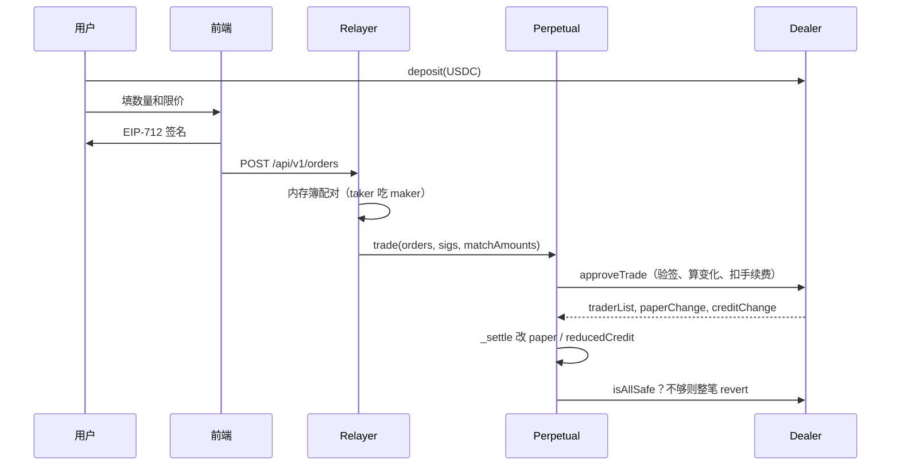
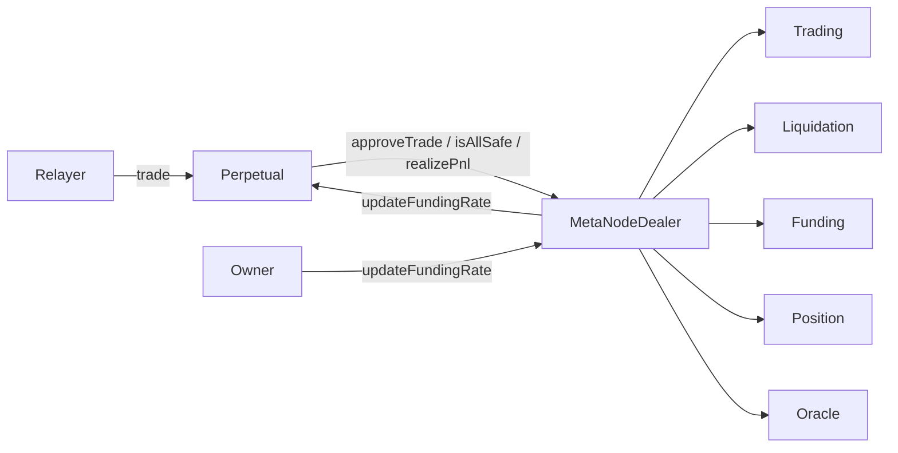
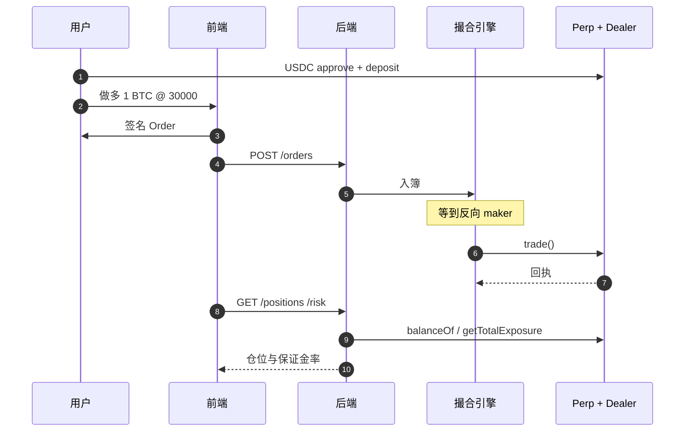

# MetaNode 永续合约项目拆解文档

> 学习目标：从**业务**理解项目。读完应能讲清 paper/credit、链下撮合链上结算、资金费、清算，以及 Relayer 为什么必须是 `validOrderSender`。  
> 代码依据：`src/`（合约）、`others/backend/`（撮合引擎）、`others/fe/`（前端）。  
> 仓库：https://github.com/MetaNodeAcademy/perpetual-contract

---

## 0. 一句话讲清这个项目

MetaNode 是一个 **链下撮合、链上结算** 的去中心化永续合约教学系统。

用户用 EIP-712 签限价单，发给后端 Relayer；Relayer 在内存订单簿里配对后，以 `validOrderSender` 身份调用 `Perpetual.trade`。合约只做三件事：验签、改 paper/credit、检查保证金够不够。资金费率用累计值写在市场合约上，所有持仓的 credit 会自动跟着变，不必逐个改存储。

它不是 NFT 市场，也不是 Pledge 那种固定期限借贷。买卖的是「锚定 BTC/ETH 现货的无限期合约」，用保证金加杠杆，靠资金费把合约价拉回现货。

---

## 1. 项目解决什么问题

永续合约让交易者不必交割现货，也能做多/做空标的价格，并且没有到期日。要把这件事做成链上协议，必须同时解决：

| 问题 | MetaNode 的做法 |
| --- | --- |
| 订单太多，链上撮合太贵 | 订单在链下签名，Relayer 撮合后再一笔上链 |
| 仓位怎么记账 | 每个市场一个 `Perpetual`：`paper`（张数）+ `credit`（资金） |
| 多市场共用保证金 | `MetaNodeDealer.primaryCredit` 全仓，跨 BTC/ETH 共享 |
| 合约价偏离现货 | 累计 `fundingRate`，多空互相付钱 |
| 保证金不足 | 任何人可 `liquidate`，折扣接手仓位，坏账进保险账户 |

和中心化交易所（Binance 永续）的差别：撮合仍在服务器，但**结算、保证金、清算规则在合约里**，Relayer 不能凭空改你的仓位——必须带上你签过的单。

和 Pledge / NFTMarket 对照：

| | Pledge | NFTMarket | MetaNode 永续 |
| --- | --- | --- | --- |
| 链上核心 | 资金池状态机 | 订单簿 + Vault | Perpetual 资产负债表 + Dealer |
| 订单在哪 | 无订单 | 链上 | **链下签名** |
| 后端角色 | 轮询 view | 扫事件 | **撮合引擎，会发 `trade()`** |
| 钱谁管 | PledgePool | Vault | Dealer 里的 USDC 保证金 |

注意：这里的后端**会发交易**，但发的是「把已签名订单提交结算」，不能替用户动保证金（存款用户自己 `deposit`）。

---

## 2. 仓库怎么拆

```
perpetual-contract/
├── src/                      # 智能合约（Foundry）
│   ├── Perpetual.sol         # 单个市场的 paper/credit
│   ├── MetaNodeDealer.sol    # 入口：保证金、验签、清算、资金费
│   ├── libraries/            # Trading / Liquidation / Funding / Position
│   ├── oracle/               # 标记价格
│   └── subaccount/           # 子账户
├── test/                     # 场景测试（开平仓、资金费、清算）
├── others/
│   ├── backend/              # go-zero：订单 API + 内存撮合 + 上链
│   └── fe/                   # Next.js：签名下单、存保证金、看仓位
└── docs/                     # 已有业务 PDF / 仓位说明
```

读代码时记住：**仓位在 Perpetual，保证金在 Dealer，订单在 Relayer 内存里，签名才是用户授权。**

---

## 3. 整体架构图

```mermaid
flowchart TB
    subgraph 用户
        A[交易者 A]
        B[交易者 B]
        Wallet[钱包 EIP-712]
    end

    subgraph 前端 others/fe
        Trade[下单页]
        Account[账户 存取保证金]
    end

    subgraph 后端 others/backend
        API[HTTP API]
        Book[内存订单簿]
        Relayer[MatchEngine 上链]
        Keeper[FundingRateKeeper]
        Liq[Liquidator]
        DB[(Postgres)]
    end

    subgraph 链上
        Dealer[MetaNodeDealer]
        BTC[Perpetual BTC-PERP]
        ETH[Perpetual ETH-PERP]
        USDC[USDC]
        Oracle[MarkPriceSource]
    end

    A --> Wallet
    Wallet --> Trade
    Trade -->|POST /orders + 签名| API
    API --> Book
    Book --> Relayer
    Relayer -->|trade(tradeData)| BTC
    BTC -->|approveTrade| Dealer
    Account -->|deposit / withdraw| Dealer
    Dealer --> USDC
    Dealer --> Oracle
    Dealer -->|updateFundingRate| BTC
    Relayer --> DB
    API --> DB
```

**分工一句话：**

- **Perpetual**：这个市场里谁多谁空、paper/credit 多少。
- **Dealer**：USDC 保证金、验签撮合结果、全仓风险、清算、资金费入口。
- **Relayer**：链下配对，必须是 `validOrderSender` 才能让 `approveTrade` 通过。
- **前端**：签名 + 存款；仓位展示走 API（API 再读链或库）。

---

## 4. 角色、仓位与订单

### 4.1 角色

| 角色 | 做什么 | 链上动作 |
| --- | --- | --- |
| 交易者 | 存 USDC、签名开平仓 | `deposit`；不直接调 `trade` |
| Relayer / orderSender | 撮合后提交成交 | `Perpetual.trade(tradeData)` |
| FundingRateKeeper | 定期写累计资金费 | `Dealer.updateFundingRate` |
| 清算者 | 吃不安全仓位 | `Perpetual.liquidate` |
| Owner | 注册市场、设保险账户、授权 Relayer | `setPerpRiskParams` 等 |
| 保险账户 | 收清算保险费、扛坏账 | 被 `handleBadDebt` 记账 |

### 4.2 paper / credit（贯穿全项目的账本）

每个市场、每个用户只有两个数：

| | 做多 1 BTC @ 30000 | 做空 1 BTC @ 30000 |
| --- | --- | --- |
| paper | +1e18 | -1e18 |
| credit | -30000e6 | +30000e6 |

读成：「我手里有 +1 张 BTC 纸，同时欠 30000 USDC」或反过来。  
**未实现盈亏不单独存。** 现价来了用：

```
仓位价值 = paper × markPrice + credit
```

BTC 涨到 31000：多头价值 = 1×31000 + (-30000) = +1000；空头 = -1×31000 + 30000 = -1000。这就是永续盈亏。

精度习惯：paper 用 1e18，USDC credit 用 6 位。订单里 `price ≈ |credit| / |paper|`。

### 4.3 订单（链下签、链上验）

```
Order {
  perp, signer,
  paperAmount,   // 正做多，负做空
  creditAmount,  // 必须与 paper 异号
  info           // 打包 makerFee / takerFee / expiration / nonce
}
```

EIP-712 类型哈希在 `Types.ORDER_TYPEHASH`。成交价用 **Maker 价**，Taker 价当限价保护。

---

## 5. 核心业务流程



只有三种操作会改 Perpetual 余额：**交易、资金费、清算**。存款只改 Dealer 的 `primaryCredit`。

---

## 6. 合约层

### 6.1 合约如何协作



`MetaNodeDealer` 是拼盘入口：

- `MetaNodeStorage`：所有状态
- `MetaNodeExternal`：用户与 Perp 回调
- `MetaNodeOperation`：管理员
- `MetaNodeView`：查询

一个 Dealer 挂多个 Perpetual（BTC-PERP、ETH-PERP）。Perpetual 的 `owner` 就是 Dealer。

| 文件 | 职责 |
| --- | --- |
| `Perpetual.sol` | paper/reducedCredit、trade、liquidate、fundingRate |
| `MetaNodeDealer.sol` | 顶层入口 |
| `libraries/Trading.sol` | 验价、按 Maker 价成交、手续费 |
| `libraries/Liquidation.sol` | 净值/敞口、IM/MM、清算折扣、坏账 |
| `libraries/Funding.sol` | 存取款、时间锁 |
| `libraries/Position.sol` | openPositions 列表、平仓 realizePnl |
| `libraries/EIP712.sol` | 域分隔与订单哈希 |
| `oracle/*` | 标记价格 |
| `subaccount/*` | 独立保证金账户，钱包当 owner |

### 6.2 用户 / Relayer 操作 → 合约方法

| 业务 | 方法 | 谁能调 | 改什么 |
| --- | --- | --- | --- |
| 存保证金 | `Dealer.deposit` | 用户 | `primaryCredit +=`，USDC 转入 Dealer |
| 申请取款 | `requestWithdraw` | 用户/操作员 | 记下 pending + 时间锁 |
| 执行取款 | `executeWithdraw` | 用户 | 转出 USDC，取后须 IM 安全 |
| 快速取款 | `fastWithdraw` | 白名单 | 跳过时间锁 |
| 提交成交 | `Perpetual.trade` | 任意人调用，但 **orderSender 须在白名单** | paper/credit |
| 清算 | `Perpetual.liquidate` | 任意人 | 折扣换仓，可能 handleBadDebt |
| 更新资金费 | `Dealer.updateFundingRate` | fundingRateKeeper | Perp.fundingRate 累计值 |

`trade` 的 `msg.sender` 才是 orderSender。普通人调 `trade` 会在 `approveTrade` 里被 `INVALID_ORDER_SENDER` 挡住。

### 6.3 资金费率为什么不改每个用户的存储

```
credit = paper × fundingRate + reducedCredit
```

`fundingRate` 是**累计值**，绝对值没意义，**变化量**才是本期费率。  
Keeper 把累计值从 `F` 改成 `F+Δ`：

- 多头 paper>0：credit 自动 + paper×Δ
- 空头 paper<0：credit 自动 - |paper|×Δ

只写一个 slot，所有持仓「被结算」。这是本项目最值得讲的存储技巧。

业务含义（和 CEX 一致）：合约价高于现货 → Δ 为正 → 多头付钱给空头，抑制过多多头。

### 6.4 成交怎么改账

`Trading._matchOrders`：

1. 至少 1 个 taker + 1 个 maker；maker 按 signer 地址排序
2. taker 成交量 = 所有 maker 成交量之和
3. `_priceMatchCheck`：方向相反，且成交不劣于 taker 限价
4. 成交 credit 按 **Maker 的 credit/paper** 算
5. maker/taker 手续费从 credit 扣，进 `orderSenderFee`（Relayer）
6. 回到 Perpetual `_settle`：更新 paper 与 reducedCredit
7. 新开仓 → `openPosition`；paper 归零 → `realizePnl` 把剩余 credit 打进 `primaryCredit`

### 6.5 风险与清算

全仓口径（`Liquidation.getTotalExposure`）：

```
仓位价值 = Σ (paper × markPrice + credit)
净值     = 仓位价值 + primaryCredit + secondaryCredit
敞口     = Σ |paper × markPrice|
初始保证金 IM = 敞口 × initialMarginRatio
维持保证金 MM = 敞口 × liquidationThreshold
```

- MM 不够：可被清算（`isSafe == false`）
- IM 不够：不能新开仓 / 普通取款
- Solid IM：取主资产时不能靠次级资产撑场面

清算：以 `markPrice × (1 ± liquidationPriceOff)` 折扣把仓位转给清算者，再抽 `insuranceFeeRate` 进保险账户。仓位清零若 `primaryCredit < 0`，保险账户扛坏账。

`expectCredit` 是清算者的滑点保护，执行价差过大会 revert。

### 6.6 保证金进出

存款不经 Relayer。取款两步是为了避免「链下单还在簿上、链上保证金已经被提走、成交时才发现不安全」。时间锁窗口内 Relayer 还能把单成交或撤销。

---

## 7. 后端层

路径：`others/backend/`，go-zero。

| 模块 | 职责 |
| --- | --- |
| `handler/` + `logic/order` | 收签名订单，写入 DB，丢进撮合引擎 |
| `engine/matchengine.go` | 内存价档 FIFO；新单当 taker 吃簿上 maker |
| `engine/orderbook.go` | 每个 perp 一本买卖盘 |
| `chain/` | ABI、EIP-712 打包、`BuildMatchTradeData`、发 `trade()` |
| `engine/fundingratekeeper.go` | 调 `updateFundingRate` |
| `engine/liquidator.go` | 扫不安全账户（教学项目里偏 stub） |
| `logic/position` | 读链或库，给前端仓位/风险 |
| `listener/treasurydepositwatcher.go` | 链下 ledger 入账（**不等于** Dealer.deposit） |

Relayer 私钥必须对应链上 `validOrderSender`。撮合成功后编码：

```
abi.encode(Order[], signatures[], matchPaperAmount[])
```

再 `Perpetual.trade`。链上 revert 时订单不该标成已成交（todo 里仍提示过这个坑）。

API 骨架在 `metanode.api`：`/api/v1/orders`、positions、balance、risk、markets、kline、funding-rates。部分列表接口仍是占位。

和 NFTMarket Sync 的差别：Sync **只读日志**；这里的引擎 **会写链**。和 Pledge schedule 的差别：Pledge **不撮合**。

---

## 8. 前端层

路径：`others/fe/`。

| 能力 | 文件 |
| --- | --- |
| EIP-712 组单/打包 info | `lib/metanode-order.ts` |
| 调 Dealer 存取款 | `lib/metanodeDealer.ts` |
| REST | `lib/metanode-api.ts` |
| 标记价/资金费展示 | `lib/funding.ts`、`lib/market-quote.ts` |

用户下单：本地算 `paperAmount`/`creditAmount`（paper 1e18，credit 6 位 USDC）→ `signTypedData` → `POST /orders`。  
存保证金：钱包直接 `Dealer.deposit`。账户页还曾区分 Treasury 链下充值和 Dealer 链上保证金，产品上不要混。

---

## 9. 三端数据流转



三条铁律：

1. **没有签名就不能改仓位。** Relayer 不是托管方。
2. **保证金在 Dealer，仓位在 Perp。** 看余额要两处一起看。
3. **列表和盘口可以在内存里；结算必须以链为准。**

---

## 10. 从业务角度怎么读代码

1. `Types.sol` 的 `Order`、`RiskParams`、`State`（1 小时）
2. `Perpetual.balanceOf` + `_settle` + funding 公式（1 小时）
3. `MetaNodeExternal.approveTrade` + `Trading._matchOrders`（2 小时）
4. `Liquidation.getTotalExposure` 与 `isSafe`（1 小时）
5. `Funding.deposit` / 两步取款（30 分钟）
6. 对照 `others/backend/internal/engine/matchengine.go` 看 tradeData 怎么拼（1 小时）

测试入口：`test/impl/ScenarioTradingTest.sol`（开平仓）、`ScenarioFundingRateTest.sol`、`ScenarioLiquidationTest.sol`。

---

## 11. 讲解提纲

**1. 这是什么**  
链下撮合、链上结算的永续合约。全仓 USDC 保证金，资金费锚定现货。

**2. 仓位怎么记**  
paper 正负表示多空，credit 是对应的美元账。净值用标记价当场算，不存浮盈字段。

**3. 为什么资金费只改一个变量**  
`credit = paper * fundingRate + reducedCredit`，改累计费率等于给所有人结算。

**4. 谁能成交**  
只有 `validOrderSender` 提交的、带用户 EIP-712 签名的 tradeData。

**5. 后端干什么**  
订单簿 + 把配对结果打成 `trade()`。不能替用户 deposit。

**6. 风险点**  
Relayer 审查/宕机则无法成交（结算仍安全）；资金费 Keeper 不更新则基差不收敛；清算依赖有人来叫 `liquidate`。

---

## 12. 读完后的自检

1. 做多 1 BTC @ 30000，paper 和 credit 符号是什么？
2. 标记价变了，链上哪个存储字段会立刻变？
3. 用户为什么几乎从不自己调 `Perpetual.trade`？
4. 成交价用 Maker 还是 Taker？
5. 平仓后钱回到哪里（Perp 还是 `primaryCredit`）？
6. 资金费更新有没有 for 循环用户？
7. MM 不够和 IM 不够分别限制什么？
8. `requestWithdraw` 为什么要时间锁？
9. Relayer 没被 `setOrderSender` 会怎样？
10. 这套系统和 NFTMarket 的「链上订单簿」本质差别是什么？
